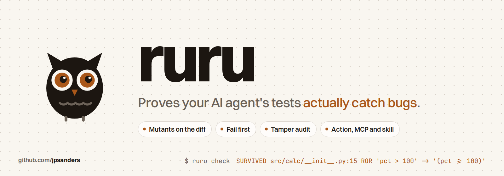

<p align="center">
  <picture>
    <source media="(prefers-color-scheme: dark)" srcset="https://raw.githubusercontent.com/jpsanders/ruru-review/main/docs/images/banner-dark.png">
    
  </picture>
</p>

<p align="center">
  <a href="https://github.com/jpsanders/ruru-review/actions/workflows/dev.yml"></a>
  <a href="https://github.com/jpsanders/ruru-review/releases/latest"></a>
  <a href="https://pypi.org/project/ruru-review/"></a>
  <a href="https://github.com/marketplace/actions/ruru-pr-reviewer"></a>
  <a href="https://www.python.org/downloads/"></a>
  <a href="#with-your-ai-agent"></a>
  <a href="#with-your-ai-agent"></a>
  
  
  <a href="https://mypy-lang.org/"></a>
  <a href="https://github.com/psf/black"></a>
  <a href="LICENSE"></a>
  <a href="https://github.com/jpsanders/ruru-review/commits/main"></a>
  <a href="https://github.com/jpsanders/ruru-review/stargazers"></a>
</p>

Your agent says the tests pass. ruru checks whether they would notice a bug.

ruru reviews a pull request the way a strict reviewer would, and answers with evidence instead of opinion:

1. **Tamper audit.** Did the change delete, loosen or skip a test to get to green?
2. **Fail first.** Do the new tests fail without the change, or do they pass either way?
3. **Mutants on the diff.** ruru plants small bugs in the changed lines, `<` for `<=`, `and` for `or`, and runs
   your tests. Every bug that survives is a gap.

It calls no model and needs no API key. Your code never leaves the machine or the CI runner. It is the
standard library only, starts in 40 ms, and reviewed the agent pull request below in 1.6 seconds.

```sh
uvx --from ruru-review ruru check            # your branch against main, uncommitted work included
```

## What it catches

An agent was asked to add a discount function. It wrote one test, `assert discount(100, 10) is not None`, deleted
an assertion it could not satisfy, loosened another and skipped a third test. The suite is green. ruru:

```text
$ ruru check
ruru 1.0.0  base main (5c93625fee)  head working tree
  tamper      3 high, 0 medium
  fail first  5 test(s): 1 prove the change, 3 pass without it, 0 fail at the head
  mutants     score 25%: 2 killed, 6 survived, 1 not covered, 0 skipped, of 9
  gate        FAIL for an agent change (branch claude/discount)
              - 3 high tamper finding(s)
              - 3 new or changed test(s) pass without the change
              - diff mutation score 25% is under 70%

TAMPER      tests/test_calc.py:6 assertion-removed: test_add has 1 fewer assertion(s) than before
TAMPER      tests/test_calc.py:10 assertion-loosened: test_add_identity traded exact assertions for weaker ones
TAMPER      tests/test_calc.py:20 skip-added: test_negative gained a skip or xfail
SURVIVED    src/calc/__init__.py:15 ROR 'pct > 100' -> '(pct >= 100)'  [ROR-822e815b28]
NOT_COVERED src/calc/__init__.py:16 CRP '"pct over 100"' -> '""'  [CRP-45bdad979b]
SURVIVED    src/calc/__init__.py:17 AOR 'price * pct' -> '(price / pct)'  [AOR-80c2d92c92]
```

Each survivor is a test your agent should have written. Hand it the report and it writes them; `ruru verify` proves
each one kills its mutant.

## Why

Agents write code faster than people can review it, and they are rewarded for green builds. The cheapest way to green
is a weaker test. Coverage does not notice: a test that runs a line without checking its result covers it all the
same.

Mutation testing does notice, and the industry has moved to it for exactly this reason:

- Thoughtworks moved mutation testing to **Adopt** on its Technology Radar in November 2026, as a guardrail
  against AI generated tests that inflate coverage.
  ([radar](https://www.thoughtworks.com/radar/techniques/mutation-testing))
- Google runs mutants on changed code during code review, for more than 24,000 developers, and filters out
  unproductive ones the way ruru's arid rules do. (Petrović, Ivanković, Fraser and Just, IEEE TSE 2021)
- Meta's ACH uses mutants to judge the tests an LLM writes; engineers accepted 73% of them.
  (FSE 2025)

ruru brings that to any Python repository, scoped to the diff so it stays fast, with two checks aimed at agents in
particular: tests that prove nothing, and tests that were quietly weakened.

## Install

```sh
uv tool install ruru-review          # or: pipx install ruru-review, or: pip install ruru-review
ruru --version
```

ruru needs Python 3.14 or later for itself. The projects it reviews can use any Python from 3.9 on: ruru runs their
tests with their own interpreter (`.venv`, the active virtualenv, or `--python`). Install `pytest-cov` in the
project and each mutant runs only the tests that reach its line.

## Use

```sh
ruru check                       # the working tree against main: all three checks
ruru check --base develop        # another target branch
ruru check --head HEAD           # the last commit, ignoring uncommitted work
ruru check --all                 # score the whole repository's tests, not a change
ruru check --json report.json    # the report an agent works from
ruru audit                       # only the tamper audit: static, no tests run, under a second
ruru mutants                     # list the mutants without running them
ruru verify ROR-822e815b28       # after writing a test: is that mutant dead now?
ruru guide                       # the full manual, for people and agents
man ruru                         # the same, after ruru man --install
```

Exit codes: 0 pass or advice, 1 the gate failed, 2 ruru could not test the project (and says why).

## In GitHub Actions

Two workflows, because pull request code must never run with a write token. Copy both from
[`examples/workflows/`](examples/workflows/):

```yaml
# .github/workflows/ruru.yml: runs the tests read only, safe for forks
on: pull_request
permissions:
  contents: read
jobs:
  ruru:
    runs-on: ubuntu-latest
    steps:
      - uses: actions/checkout@v7
        with: { fetch-depth: 0, persist-credentials: false }
      - uses: actions/setup-python@v7
        with: { python-version: "3.15" }
      - run: python -m pip install -e . pytest pytest-cov
      - uses: jpsanders/ruru-review@1.0.0
        with: { report: ruru/ruru-report.json }
      - uses: actions/upload-artifact@v4
        if: always()
        with: { name: ruru-report, path: ruru/ }
```

`ruru-post.yml` then comments on the pull request from that report, without checking out its code: one summary
comment updated in place, and at most five inline comments, most serious first. Each comment names the gap and hints
at a test. None proposes code.

The gate is enforced for pull requests written by agents (by author, branch prefix such as `claude/` or `copilot/`,
co author trailer, or an `agent` label) and is advice for people. `mode: gate` enforces it for everyone. The action
also writes SARIF (`ruru-report.sarif`) for code scanning, annotations on the diff and a job summary, and outputs
`score`, `survived`, `tamper-high` and `gate`.

## With your AI agent

The best time to catch a weak test is before the agent says it is done.

**Claude Code**, the plugin (a skill plus the MCP server):

```text
/plugin install ruru --marketplace jpsanders/ruru-review
```

**Any MCP client** (Claude Desktop, Cursor, VS Code, Codex, Windsurf), the server alone:

```json
{ "mcpServers": { "ruru": { "command": "uvx", "args": ["--from", "ruru-review", "ruru", "mcp"] } } }
```

```sh
claude mcp add ruru -- uvx --from ruru-review ruru mcp     # Claude Code, without the plugin
```

The server offers `ruru_check`, `ruru_survivors`, `ruru_explain`, `ruru_verify` and `ruru_audit`. The loop: check,
write a test for each survivor, verify it, check again, and never weaken a test to pass.

**Agents without MCP** follow the same loop through the command line and `--json`; put the four lines from
[AGENTS.md](AGENTS.md#check-your-own-change-with-ruru) in yours. To stop Claude Code from finishing while the gate
fails, add the opt in [Stop hook](docs/hooks/stop-hook.md).

**Make**, so it runs with your other checks:

```make
ruru:
	uvx --from ruru-review ruru check --base origin/main --mode gate
```

## How it works

- **The change.** The merge base of the target branch and the head, or the working tree. Only changed lines are
  mutated, so a review takes seconds, not the minutes a full mutation run takes.
- **Mutants.** Nine operators parsed from the syntax tree, not regular expressions: comparisons, conditions,
  returns, arithmetic, boolean operators, constants, augmented assignment, loop control and deleted calls. Logging,
  docstrings, type annotations, `__repr__` and other code where a mutant cannot matter are never mutated, after
  Google's arid node rules. `# ruru: ignore[ROR]` skips a line.
- **Isolation.** Mutants run in git worktrees, never in your checkout, several in parallel. An import check stops the
  run when an installed copy of the package would shadow the mutants, so a broken setup cannot pass as a perfect
  score. A baseline must pass first; timeouts kill the whole process group.
- **Deterministic.** Sampling is seeded by the head commit. Two runs on one commit write the same report.
- **Fail first.** The new tests run at the head and on the base with the head's test files laid over it. Imports of
  names the base does not have become placeholders, so one new import does not hide every test in the file.
- **Tamper audit.** Compares the base and head syntax trees of every test, `conftest.py`, test and coverage
  configuration and CI workflow. A renamed test is compared with its old self. A conditional skip is medium; a bare
  skip is high.

The [manual](docs/MANUAL.md) has every rule, operator, option and the report schema.

## Configuration

Everything has a default. To change one, add `[tool.ruru]` to the reviewed project's `pyproject.toml`:

```toml
[tool.ruru]
base = "main"
max-mutants = 60
time-budget = 600
arid = ["metrics.*"]

[tool.ruru.gate]
min-score = 0.70
```

## Compared with

The nearest open tools, as of November 2026:

| | ruru | irradiate | Mutahunter |
|---|---|---|---|
| Mutants on the changed code | yes | yes | yes |
| Fail first check | yes | no | no |
| Tamper audit of tests | yes | no | no |
| Gate for agent pull requests | yes | no | no |
| Who writes the mutants | the syntax tree, deterministic | the syntax tree | an LLM |
| MCP server and agent skill | yes | no | no |
| Licence | MIT | | AGPL |

For a deep mutation campaign over a whole codebase, use a dedicated tool such as mutmut. Use ruru on every pull
request.

## Why the name

The ruru is the morepork, New Zealand's small brown owl. It hunts at night and sees what moves in the dark, and
in Māori tradition it is a watchful guardian. A reviewer for code written while you sleep.

## Development

```sh
git clone https://github.com/jpsanders/ruru-review && cd ruru-review
python3.15 -m venv .venv && . .venv/bin/activate && make init-dev
make checks     # isort, black, editorconfig, darglint, flake8, mypy strict, bandit, man page, pytest
```

ruru reviews its own pull requests. See [CONTRIBUTING.md](CONTRIBUTING.md) and [AGENTS.md](AGENTS.md).

## Star history

<a href="https://star-history.com/#jpsanders/ruru-review&Date">
  <picture>
    <source media="(prefers-color-scheme: dark)" srcset="https://api.star-history.com/svg?repos=jpsanders/ruru-review&type=Date&theme=dark">
    
  </picture>
</a>

## Licence

MIT. Specified and tested by [James Phillip Sanders](https://jamesphillipsanders.com).
